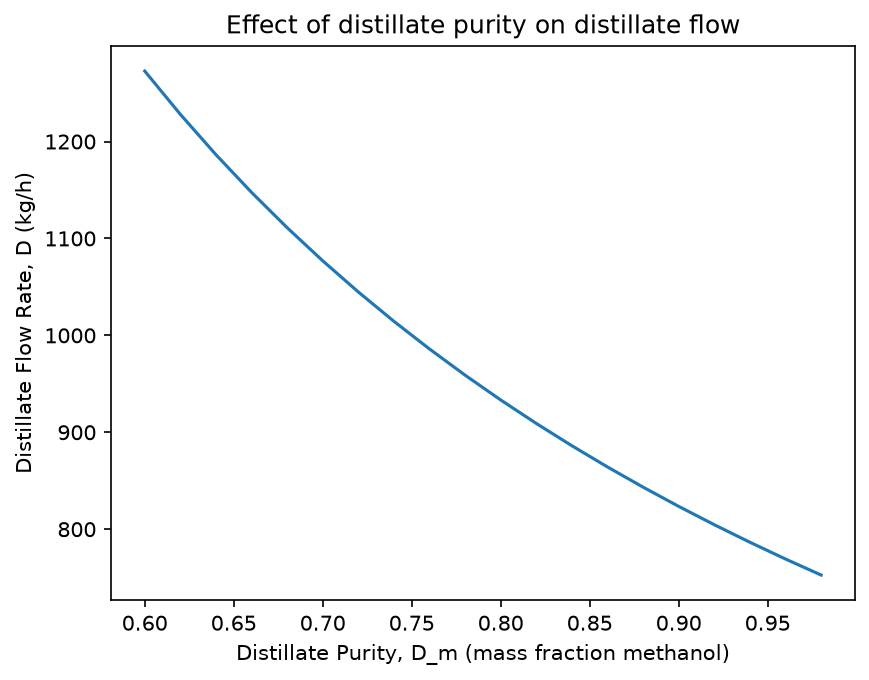
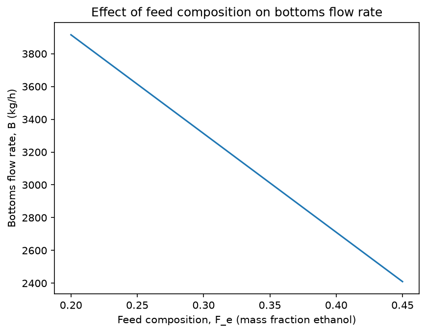

# TCH 201: Mass and Energy Balances with Python

Learning to model and solve material and energy balance problems in Python (TCH 201, course outcome 7). Each stage has its own folder, and the checklist below tracks progress.

## Roadmap

- [x] **Stage 1:** Steady-state balances, no reaction
- [ ] **Stage 2:** Multiple units, recycle, bypass, purge
- [ ] **Stage 3:** Reactive systems
- [ ] **Stage 4:** Data handling and presentation
- [ ] **Stage 5:** Energy balances
- [ ] **Stage 6:** Optimization and capstone

## Stage 1: Steady-state balances

Folder: `stage1_steady_state/`

| File | What it does |
|---|---|
| `stage1_column_balance.py` | First distillation column balance, solved with `np.linalg.solve` |
| `stage1_column_balance2.py` | The balance wrapped in a reusable `column_balance` function |
| `stage1_column_balance3.py` | Distillate flow against distillate purity, checked against the algebraic formula |
| `stage1_assessment.py` | Checkpoint: ethanol column, bottoms flow against feed composition |

### Distillate flow vs distillate purity (methanol/water column)



Demanding a purer distillate means less of the feed leaves as distillate, so D falls as the purity rises.

### Bottoms flow vs feed composition (ethanol/water column)



A richer feed lets more material leave as distillate, so B falls in a straight line as the feed composition rises.

## Running the code

Install the libraries once:

```
python -m pip install numpy matplotlib
```

Run any script from the main folder, for example:

```
python stage1_steady_state/stage1_column_balance3.py
```

Each plot script saves its graph into the `images` folder next to it.